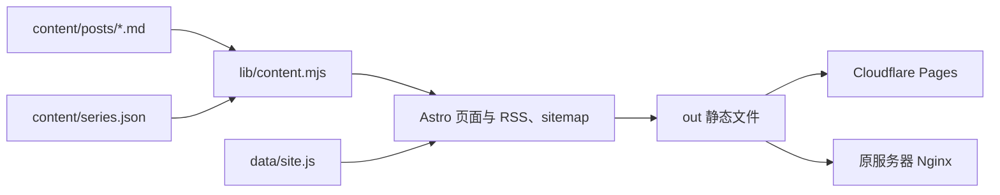

# 代码仓库结构

当前网站由 Astro 构建成静态文件。Markdown 文章、页面组件和站点配置在构建时合并，产物写入 `out/`。浏览器负责主题、导航、文章筛选和视觉效果。

当前博客由 Node.js 构建，发布过程不依赖 Python 服务。

## 目录索引

以下是主要目录，省略具体文章、图片、依赖和编辑器配置。

```text
zero-to-tech/
├── src/
│   ├── pages/                      Astro 页面和静态端点
│   │   ├── index.astro             首页
│   │   ├── blog/
│   │   │   ├── index.astro         文章列表
│   │   │   └── [slug].astro        文章详情、目录和阅读进度
│   │   ├── series/                 系列列表和系列详情
│   │   ├── about.astro             关于页
│   │   ├── works.astro             作品页与项目数据
│   │   ├── 404.astro               未找到页面
│   │   ├── sitemap.xml.ts          网站地图
│   │   ├── robots.txt.ts           搜索引擎抓取规则
│   │   └── design/loading.astro    旧地址，重定向到首页
│   ├── layouts/
│   │   └── Layout.astro            页面外壳、SEO、主题初始化
│   ├── components/                 站点组件，详见下表
│   │   └── starwind/Button.astro   Astro 按钮封装
│   ├── scripts/                    浏览器交互与绘制代码
│   └── endpoints/rss.ts            按构建开关注入的 RSS 端点
├── content/
│   ├── posts/                      Markdown 文章
│   └── series.json                 系列定义
├── templates/post.md               新文章模板
├── lib/
│   ├── content.mjs                 内容读取、校验、渲染和 RSS 生成
│   └── date.mjs                    日期显示格式
├── data/site.js                    站点信息、联系方式、友链和发布开关
├── css/                            全局样式、主题与公共效果
├── public/
│   ├── images/                     头像、友链头像、文章配图
│   └── diagrams/                   文章中的独立交互图 HTML
├── scripts/
│   ├── check-content.mjs           构建前的内容检查
│   ├── preview.mjs                 本地静态预览服务器
│   └── deploy.sh                   原服务器的静态文件发布
├── tests/                          Node 测试与浏览器检查函数
├── .github/workflows/publish.yml   自动测试、构建和发布
├── deploy/nginx.conf               静态网站 Nginx 配置示例
├── docs/                           维护文档
├── .pages.yml                      Pages CMS 的文章与图片配置
├── astro.config.mjs                Astro、Tailwind 和 RSS 路由配置
├── package.json                    JavaScript 依赖与命令
└── tsconfig.json                   TypeScript 配置
```

完整文件清单可以在仓库根目录查看。下面的命令也会列出尚未提交且未被忽略的文件：

```bash
git ls-files --cached --others --exclude-standard
```

## 页面与组件的对应关系

| 功能                               | 入口与主要文件                                                                                       |
| ---------------------------------- | ---------------------------------------------------------------------------------------------------- |
| 首页栏目总览                       | `src/pages/index.astro`、`src/components/HomeView.astro`                                             |
| 首次入站的 ASCII 开场              | `src/components/ASCIIIntro.astro`、`src/scripts/ascii-text.js`，由首页引用                           |
| 公共页面结构                       | `src/layouts/Layout.astro`、`SiteHeader.astro`、`SiteFooter.astro`                                   |
| 顶部导航与手机菜单                 | `Nav.astro`、`SiteHeader.astro`、`src/scripts/navigation.ts`、`mobile-menu.ts`                       |
| 深浅色切换                         | `ThemeSwitcher.astro`、`ThemeIcon.astro`、`src/scripts/theme.ts`                                     |
| 文章列表与标签筛选                 | `src/pages/blog/index.astro`、`BlogIndex.astro`、`PostList.astro`                                    |
| 文章目录、阅读进度、正文交互图嵌入 | `src/pages/blog/[slug].astro`                                                                        |
| 系列页面                           | `src/pages/series/index.astro`、`src/pages/series/[slug].astro`                                      |
| 关于页章节导航                     | `src/pages/about.astro`、`SectionNav.astro`                                                          |
| 联系方式与友链                     | `SocialLinks.astro`、`SiteFooter.astro`、`data/site.js`                                              |
| 按钮高光                           | `css/specular-button.css`、`src/scripts/specular-buttons.ts`、`src/components/starwind/Button.astro` |
| 流星背景与切页连续性               | `MeteorBackground.astro`、`src/scripts/transitions.ts`                                               |
| 页面切换时的监听绑定与释放         | `src/scripts/page-lifecycle.ts` 的 `onPageChange()`                                                  |

表中未带目录的 `.astro` 组件位于 `src/components/`。

页面组件也可以包含自己的 `<script>` 和 `<style>`。例如，文章阅读进度的计算和样式目前都在 `src/pages/blog/[slug].astro`，没有单独的进度组件。

## 内容与发布流程



`getPosts()` 读取文章字段、计算阅读时长、过滤草稿并排序。`getSeries()` 组合系列定义与公开文章。`renderMarkdown()` 生成经过清理的正文 HTML 和文章目录，同时转换正文中的流程图结构。

`public/` 中的文件会复制到构建产物。两张 RAG 交互图位于 `public/diagrams/`；文章页面把符合规则的图片链接增强成正文中的 iframe。

`astro.config.mjs` 把构建产物目录设为 `out/`。只有 `RSS_ENABLED=true` 时才注入 `src/endpoints/rss.ts`。

GitHub Actions 的 `build` 先运行测试和构建。随后两个发布 job 分别执行：

- `deploy` 由 `DEPLOY_ENABLED` 控制，调用 `scripts/deploy.sh` 上传到原服务器并切换 `current` 链接。
- `pages` 为 Cloudflare Pages 单独构建，使用 Pages 的公开地址，并开启 RSS。

当前网站页面由静态文件提供。浏览器交互脚本运行在客户端，文章内容处理运行在构建阶段。

## 样式文件

| 文件                      | 职责                                                       |
| ------------------------- | ---------------------------------------------------------- |
| `css/blog.css`            | 基础重置、主题变量别名、文章正文、目录、系列和部分内页样式 |
| `css/themes.css`          | 深浅色调色板与页面渐变颜色                                 |
| `css/blocks.css`          | 首页以外的内容区块、文章列表、作品与关于页公共样式         |
| `css/tailwind.css`        | Tailwind 4 入口、`tw:` 前缀、主题映射和响应式变体          |
| `css/specular-button.css` | 按钮边缘高光、聚焦反馈和减少动态效果设置                   |

组件内的 `<style>` 与这些全局文件同时存在。页面和组件根据自身需要引入区块样式，公共布局引入基础样式、主题与按钮高光样式。

## 测试与本地产物

| 文件或目录                         | 职责                                                          |
| ---------------------------------- | ------------------------------------------------------------- |
| `tests/content.test.mjs`           | 字段规则、草稿过滤、系列、Markdown 清理和 RSS                 |
| `tests/astro-build.test.mjs`       | 用隔离内容执行 Astro 构建，检查页面与发布产物                 |
| `tests/browser/theme-controls.mjs` | 接收一个 Ego Page，检查不同宽度下的主题按钮，不自行启动浏览器 |
| `out/`                             | 生产构建生成的静态文件，Git 忽略                              |
| `.astro/`                          | Astro 本地生成数据，Git 忽略                                  |
| `node_modules/`                    | JavaScript 依赖，Git 忽略                                     |

`npm test` 运行 `tests/*.test.mjs`。`tests/browser/` 中的检查函数不在这个命令的匹配范围内。

`npm run build` 先运行内容检查，再执行 Astro 构建。`npm run dev` 启动开发服务器；`npm run preview` 和 `npm start` 使用 `scripts/preview.mjs` 提供 `out/` 中的静态文件。

## 维护文档

| 文档                           | 内容                           |
| ------------------------------ | ------------------------------ |
| `README.md`                    | 开发、写作、配置和发布的总入口 |
| `docs/repository-structure.md` | 当前目录职责和功能入口         |
| `docs/pages-cms.md`            | 网页后台写文章和管理图片       |
| `docs/production.md`           | 生产部署配置与维护记录         |
